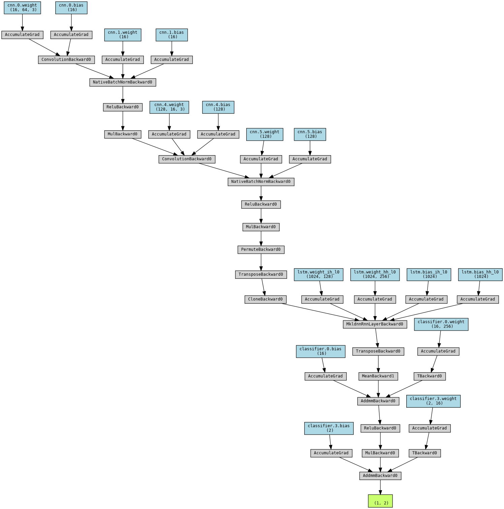

# 🧠 PhysioNet EEG Motor Movement & Imagery Classification

Deep learning and hybrid machine learning pipelines for decoding **motor movement and motor imagery** (left/right fist vs. both fists/both feet) from 64-channel EEG signals using the **PhysioNet EEG Motor Movement/Imagery Dataset (EEGMMIDB)**.



---

## 📂 Repository Structure

| File | Description |
| :--- | :--- |
| `main.ipynb` | End-to-end MNE-Python preprocessing, epoch extraction (Runs `R04`, `R08`, `R12`), and hybrid **CNN-LSTM** spatio-temporal model training with **Optuna** hyperparameter optimization. |
| `cnn_rf.ipynb` | Hybrid architecture combining convolutional feature extractors with a **Random Forest** classifier on epoched EEG motor imagery trials. |
| `CNN_LSTM_architecture_1.png` | Architectural diagram of the hybrid CNN-LSTM network used for decoding EEG motor imagery. |
| `optuna_trials_log.csv` | Logged results of automated hyperparameter tuning trials (learning rate, dropout, filter sizes, LSTM hidden units, validation accuracy). |
| `README.md` | Project documentation. |

---

## ⚙️ Signal Processing & Modeling Pipeline

1. **EDF Ingestion via MNE-Python**:
   - Loads 64-channel EDF recordings across 109 subjects from the PhysioNet EEGMMIDB dataset.
   - Focuses on motor imagery runs (`R04`, `R08`, `R12` — imagining opening/closing both fists vs. both feet).
2. **Event Extraction & Epoching**:
   - Parses annotation markers (`T1`, `T2`) and segments continuous EEG signals into fixed-length time-locked trials.
3. **Spatio-Temporal Deep Learning (CNN-LSTM & CNN-RF)**:
   - **Convolutional Layers**: Capture spatial topographies across EEG electrodes and local frequency patterns.
   - **LSTM Layers**: Model temporal dynamics over the course of the motor imagery epoch.
   - **Optuna Tuning**: Systematically searches the hyperparameter space, with trial metrics recorded in `optuna_trials_log.csv`.

---

## 🚀 Getting Started

```bash
git clone https://github.com/sparsh0106/PhysioNet-EEG-Motor-Movement.git
cd PhysioNet-EEG-Motor-Movement
pip install mne numpy pandas torch scikit-learn optuna matplotlib jupyter
jupyter notebook main.ipynb
```

---

## 👤 Author

**Sparsh Agarwal** — [GitHub](https://github.com/sparsh0106)
